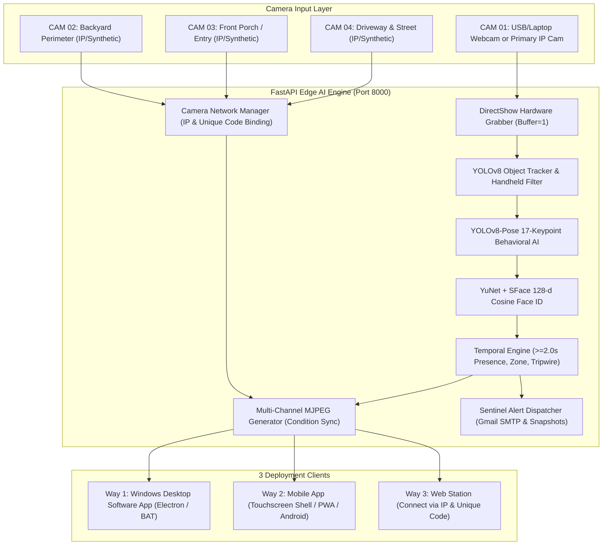
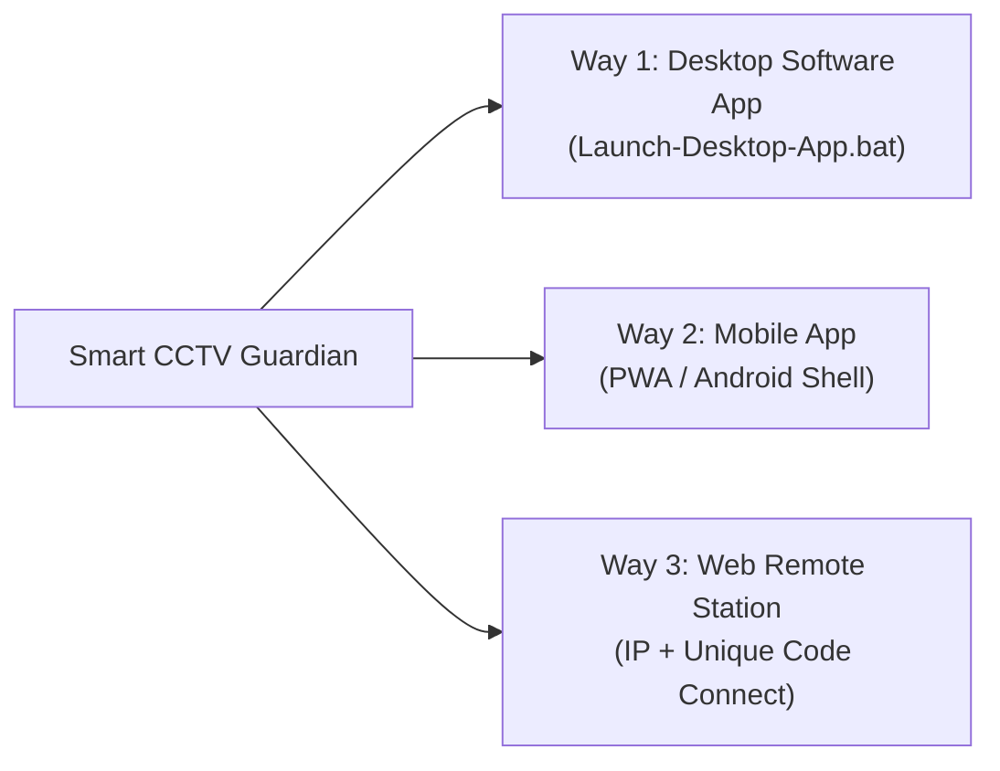
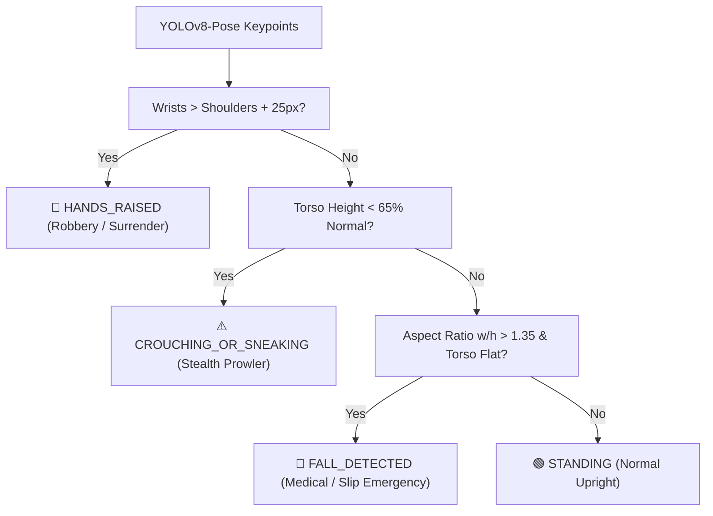
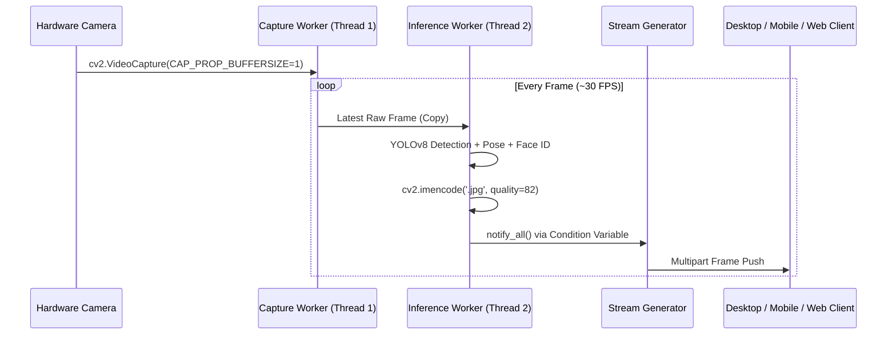

# 🛡️ Smart CCTV Guardian — Complete System Handbook & Technical Manual

> [!IMPORTANT]
> **Smart CCTV Guardian** is an enterprise-grade, edge-native AI security surveillance station. It combines **computer vision**, **pose/behavior estimation**, **face identity verification**, and a **4-channel NVR** into three unified deployment modes: a **Windows desktop app**, a **mobile touchscreen app**, and a **web-based IP camera station**.

---

## 📑 Table of Contents
1. [System Architecture & Dataflow](#1-system-architecture--dataflow)
2. [The 3 Deployment & Access Ways](#2-the-3-deployment--access-ways)
   - [Way 1: Desktop Software App (EXE / BAT via Electron)](#way-1-desktop-software-app-exe--bat-via-electron)
   - [Way 2: Mobile App (Touchscreen Interface & PWA / Capacitor)](#way-2-mobile-app-touchscreen-interface--pwa--capacitor)
   - [Way 3: Web Station & IP / Unique Code Camera Connector](#way-3-web-station--ip--unique-code-camera-connector)
3. [4-Channel NVR Interface & Wireframe Structure](#3-4-channel-nvr-interface--wireframe-structure)
   - [Main Camera Stage](#main-camera-stage)
   - [Sub-Streams Strip (v1, v2, v3)](#sub-streams-strip-v1-v2-v3)
   - [4-Camera Synchronous 2x2 Grid View](#4-camera-synchronous-2x2-grid-view)
   - [Tri-Section Right Control Station](#tri-section-right-control-station)
4. [CCTV On-Screen Display (OSD) & Telemetry](#4-cctv-on-screen-display-osd--telemetry)
5. [AI Vision, Pose, and Whitelist Engine](#5-ai-vision-pose-and-whitelist-engine)
   - [YOLOv8 Multi-Object Tracking](#yolov8-multi-object-tracking)
   - [False-Positive Suppression & Anti-Square Phone Filter](#false-positive-suppression--anti-square-phone-filter)
   - [YOLOv8-Pose 17-Keypoint Posture Analysis](#yolov8-pose-17-keypoint-posture-analysis)
   - [YuNet + SFace Resident Whitelist Engine](#yunet--sface-resident-whitelist-engine)
6. [Streaming Pipeline & Low-Latency Engine](#6-streaming-pipeline--low-latency-engine)
7. [Alerting, Media Recording & Evidence System](#7-alerting-media-recording--evidence-system)
8. [Complete REST API Reference](#8-complete-rest-api-reference)
9. [Master Troubleshooting & Operations Guide](#9-master-troubleshooting--operations-guide)

---

## 1. System Architecture & Dataflow

The system runs completely on the local edge to ensure **zero cloud subscription fees**, **100% data privacy**, and **sub-50ms inference latency**.



---

## 2. The 3 Deployment & Access Ways



### Way 1: Desktop Software App (EXE / BAT via Electron)
- **Target Audience:** Security control rooms, home command stations, dedicated monitoring PCs.
- **How It Works:**
  - Double-clicking **`Launch-Desktop-App.bat`** probes if the Python AI backend on port 8000 is running. If not, it boots the backend silently and opens the dedicated Electron desktop app.
  - The master launcher **`SmartCCTVGuardian.bat`** provides a terminal menu with 1-click launch, service termination, and GitHub synchronization.
- **Key Characteristics:**
  - **Single-Instance Execution:** Prevents duplicate memory-heavy AI processes.
  - **Zero-Latency Display:** Direct communication with the local video buffer.
  - **Offline Capability:** Built with relative asset paths (`base: './'`), loading compiled production assets without requiring a Vite dev server.

### Way 2: Mobile App (Touchscreen Interface & PWA / Capacitor)
- **Target Audience:** Remote monitoring on smartphones, tablets, or mounted touchscreens.
- **How It Works:**
  - Automatically triggers when opening the system on mobile viewports ($< 768\text{px}$) or by tapping the **"Mobile View"** button.
  - Matches the dedicated commercial mobile CCTV layout (**Reference Image 3**):
    - **Top Bar:** Armed state switch, system online beacon, active threat banner.
    - **Quick Action Carousel:** `All Feeds`, `CAM 01`, `CAM 02`, `CAM 03`, `CAM 04`, and `+ Connect IP Cam`.
    - **Vertical Camera Cards:** Each camera has high-res live streaming, OSD telemetry, instant snapshot, video clip recording, and mirror mode flip.
    - **Fixed Bottom Navigation:** 📱 **Devices**, 🚨 **Alerts**, 📡 **Connect**, and ⚙️ **Rules**.
- **Installation:**
  - **PWA Mode:** Open `http://<local_ip>:5173` on Chrome/Safari and tap **"Install App"** / **"Add to Home Screen"**.
  - **Android APK Build:** Built-in `capacitor.config.json` (`com.smartcctv.guardian`) allows compilation directly into a native Android APK using Android Studio.

### Way 3: Web Station & IP / Unique Code Camera Connector
- **Target Audience:** Any web browser on the local network or remote VPN/port forwarding.
- **Connect External IP / CCTV Cameras:**
  - Open the **"Connect Cam"** dialog.
  - Enter the **Camera IP** (e.g. `192.168.1.120`), **Port** (e.g. `554`), and **Unique Camera Code / Password**.
  - Supports **RTSP** (`rtsp://`), **HTTP/MJPEG**, and custom streaming protocols.
  - An OpenCV probe verifies the camera handshake in real time before dynamically binding it to `CAM 01`, `CAM 02`, `CAM 03`, or `CAM 04`.
  - Settings are saved to `backend/data/cameras.json` to persist across restarts.
- **NVR Station Unique Pair Code:**
  - Each station generates a persistent unique 8-character verification code (e.g. **`GRD-4212-BC38`**).
  - Users on remote devices can verify this code to authenticate and access the live multi-view station.

---

## 3. 4-Channel NVR Interface & Wireframe Structure

The interface strictly reflects the 4-channel NVR wireframe design:

```
┌─────────────────────────────────────────────────────────────────────────────────────────────────────────────────┐
│ HEADER: Brand | System Mode (Armed / Night / Disarm) | Connect IP Cam | Mobile View | Resident Whitelist        │
├─────────────────────────────────────────────────────────────────┬───────────────────────────────────────────────┤
│                                                                 │ ┌───────────────────────────────────────────┐ │
│                       MAIN CAMERA STAGE                         │ │ LOGS: Real-Time Event & AI Threat Stream  │ │
│   - Large focused live feed (High-FPS zero-buffer)              │ │ (Intrusion alerts, Pose changes, Breaches)│ │
│   - Upper-Right: Bitrate (e.g. 297 KB/s) + Monospace Clock      │ └───────────────────────────────────────────┘ │
│   - Upper-Left: [CAM 01] Channel Tag + Resolution               │ ┌──────────────────────┬────────────────────┐ │
│   - Tactical HUD: REC, Snapshot, Mirror Flip, Fullscreen        │ │ SNAPSHOTS & RECORDS  │ CONTROLS & RULES   │ │
│                                                                 │ │                      │                    │ │
├─────────────────────────────────────────────────────────────────┤ │ - Intruder photo     │ - Zone & Tripwire  │ │
│ SUB-STREAMS THUMBNAIL ROW (v1, v2, v3)                          │ │   evidence gallery   │   toggle switches  │ │
│   - Live mini thumbnails of remaining 3 cameras                 │ │ - Recorded video     │ - Pose detection   │ │
│   - 1-Click to promote any camera to Main Stage                 │ │   clips archive      │   sensitivity      │ │
│   - [⊞ 4-Cam Grid Mode Toggle]: Switches into 2x2 NVR screen    │ │ - Download / Player  │ - Resident status  │ │
└─────────────────────────────────────────────────────────────────┴─┴──────────────────────┴────────────────────┘─┘
```

### Main Camera Stage
- High-definition viewport for the active focused camera.
- **Tactical Corner Brackets:** Authentic military HUD brackets drawn in green/cyan.
- **Intrusion Banner:** Flashes during a confirmed breach ($\ge 2.0\text{s}$ duration).
- **Control Bar:** Instant recording (MediaRecorder), snapshot capture, mirror flip toggle, and fullscreen.

### Sub-Streams Strip (`v1`, `v2`, `v3`)
- Positioned directly beneath the Main Stage.
- Displays live sub-streams for the 3 non-focused cameras labeled with tactical **`v1`**, **`v2`**, and **`v3`** badges.
- Clicking any sub-stream thumbnail promotes it to the Main Stage.

### 4-Camera Synchronous 2x2 Grid View
- Modeled directly on commercial NVR displays (**Reference Images 1 & 2**).
- Displays all 4 cameras simultaneously in a $2\times2$ quadrant layout.
- Each quadrant carries individual OSD bitrate and live clock data.
- Clicking any quadrant returns to the Focused Main Stage with that camera selected.

### Tri-Section Right Control Station
- **Top Box (`LOGs`):** Dedicated live security telemetry stream displaying timestamped event cards (`CRITICAL`, `HIGH`, `MEDIUM`), confidence metrics, and posture indicators.
- **Bottom-Left Box (`Snapshots and records`):** Visual evidence gallery with snapshot previews and Sentinel video recording clips.
- **Bottom-Right Box (`Controls & Rules`):** Quick tactical toggles for Restricted Zone, Perimeter Tripwire, AI Pose & Sneak analysis, Weapon & Handheld item scanning, and Resident Face whitelist status.

---

## 4. CCTV On-Screen Display (OSD) & Telemetry

Both video streams and UI overlays feature authentic CCTV surveillance telemetry:

| OSD Element | Position | Format / Example | Purpose |
| :--- | :--- | :--- | :--- |
| **Bitrate Monitor** | Upper Right | `[297 KB/s]` (Fluctuating) | Real-time bandwidth indicator based on compression activity. |
| **Monospace Clock** | Upper Right | `22/10/2026 12:45:00` | Synchronized timestamp verifying zero frame drops or freezing. |
| **Channel Label** | Upper Left | `[CAM 01] MAIN ENTRANCE` | Channel identifier and custom camera name. |
| **Resolution / Mode** | Lower Left | `1080p HD • IR NIGHT VISION` | Sensor resolution and night vision status. |
| **Tactical HUD Corners** | Four Corners | $20\text{px} \times 2\text{px}$ Brackets | Professional NVR camera viewfinder framing. |

---

## 5. AI Vision, Pose, and Whitelist Engine

### YOLOv8 Multi-Object Tracking
- Operates YOLOv8 Nano (`yolov8n.pt`) optimized for low-latency CPU and GPU inference (~15–45ms).
- Tracks people (`class 0`), vehicles (`class 2, 3, 5, 7`), pets (`class 15, 16`), and handheld objects.

### False-Positive Suppression & Anti-Square Phone Filter
To eliminate common false alarms:
1. **2.0-Second Temporal Presence Rule:**
   - Alerts trigger only when a human target persists continuously for $\ge 2.0\text{s}$ inside the monitored area.
2. **Anti-Square Phone Filter:**
   - Rejects everyday square objects (books, notebooks, mousepads) erroneously tagged as cell phones:
     $$\text{Aspect Ratio} = \frac{\max(w, h)}{\min(w, h)} \ge 1.42$$
     $$\text{Confidence Threshold} \ge 0.65$$
3. **Wrist Proximity Validation (`is_item_held_by_hand`):**
   - Held items must be within $95\text{px}$ of wrist keypoints (9 or 10) to eliminate objects sitting on desks.

### YOLOv8-Pose 17-Keypoint Posture Analysis
Extracts 17 skeletal joints to recognize anomalous intruder behaviors:



### YuNet + SFace Resident Whitelist Engine
- **YuNet:** Ultra-fast $320\text{px}$ face detector locating facial bounding boxes and landmarks.
- **SFace:** Extracts 128-dimensional cosine feature vectors.
- **Suppression Rule:** When an authorized resident face is matched ($\text{Cosine Similarity} \ge 0.50$), all sirens and intrusion alarms are suppressed, labeling the subject in emerald green: `🟢 AUTHORIZED: RESIDENT_NAME`.
- **Zero Overhead When Empty:** Automatically skips SFace embedding extraction when 0 faces are enrolled, consuming 0% extra CPU.

---

## 6. Streaming Pipeline & Low-Latency Engine



- **Zero Socket Backlog:** Uses `threading.Condition` notifications so client streams only receive the freshest rendered frame.
- **Hardware DirectShow:** Configured with `cv2.CAP_DSHOW` and `cv2.CAP_PROP_BUFFERSIZE = 1` on Windows to eliminate frame queuing.

---

## 7. Alerting, Media Recording & Evidence System

1. **Sentinel In-Browser MediaRecorder:**
   - Records live `.webm` video clips directly in the client without loading the backend CPU.
   - Automatically begins recording upon confirmed security breaches and stores clips in the evidence drawer.
2. **Web Audio Synthesizer Alerts:**
   - Generates authentic security chimes and tactical two-tone sirens using the browser's Web Audio API (`AudioContext`), requiring zero external audio assets.
3. **Automated Gmail SMTP Alerts:**
   - Non-blocking asynchronous email delivery via `aiosmtplib` with attached high-resolution JPEG evidence frames and a 15-second cooldown timer.

---

## 8. Complete REST API Reference

| Method | Endpoint | Description |
| :--- | :--- | :--- |
| `GET` | `/api/status` | Comprehensive system telemetry, camera states, bitrates, and active detections. |
| `GET` | `/api/feed?cam={id}` | Real-time low-latency MJPEG video stream for channels 1, 2, 3, or 4. |
| `GET` | `/api/cameras` | List of all 4 NVR camera channels, IP configurations, and online states. |
| `POST` | `/api/cameras/connect` | Connects an external IP/CCTV camera via IP, port, and unique verification code. |
| `POST` | `/api/cameras/disconnect/{id}` | Resets the specified channel to its default local/virtual feed. |
| `GET` | `/api/system/device-code` | Retrieves the station's unique pair code (`GRD-XXXX-XX`) and network address. |
| `POST` | `/api/system/verify-code` | Validates a client verification code for remote authorization. |
| `POST` | `/api/mode` | Updates system state (`ARMED`, `NIGHT_MODE`, `DISARMED`). |
| `POST` | `/api/mirror` | Toggles camera horizontal flip (mirror mode). |
| `GET` | `/api/rules` | Retrieves active detection boundaries, zones, and threshold settings. |
| `POST` | `/api/rules` | Updates security zones, tripwires, loitering times, and AI filters. |
| `GET` | `/api/incidents` | Retrieves timestamped intrusion logs and snapshot evidence URLs. |
| `GET` | `/api/faces` | Lists authorized resident face profiles. |
| `POST` | `/api/faces/enroll` | Enrolls a new authorized resident face directly from the live camera frame. |
| `DELETE` | `/api/faces/{id}` | Deletes an authorized resident face profile. |
| `POST` | `/api/trigger-test-alert` | Simulates an intrusion rule breach for end-to-end testing. |

---

## 9. Master Troubleshooting & Operations Guide

### Launching & Stopping Services
- **Full System Launch:** Double-click **[start-all.bat](file:///C:/Users/Techcho/.gemini/antigravity/scratch/smart-cctv-guardian/start-all.bat)**.
- **Desktop Software App:** Double-click **[Launch-Desktop-App.bat](file:///C:/Users/Techcho/.gemini/antigravity/scratch/smart-cctv-guardian/Launch-Desktop-App.bat)**.
- **Clean Process Shutdown:** Double-click **[stop-all.bat](file:///C:/Users/Techcho/.gemini/antigravity/scratch/smart-cctv-guardian/stop-all.bat)** to release camera hardware and terminate backend servers.

### Common Diagnostics
> [!TIP]
> - **Webcam Not Detected:** Verify camera permissions in Windows Settings -> Privacy -> Camera. Run `stop-all.bat` before reconnecting.
> - **IP Camera Not Connecting:** Ensure the camera IP is reachable via ping and that port `554` (RTSP) is open. Check camera verification credentials on the device label.
> - **Mobile Phone Cannot Connect:** Confirm your smartphone is on the same local Wi-Fi network and access `http://<local_ip>:5173`.
